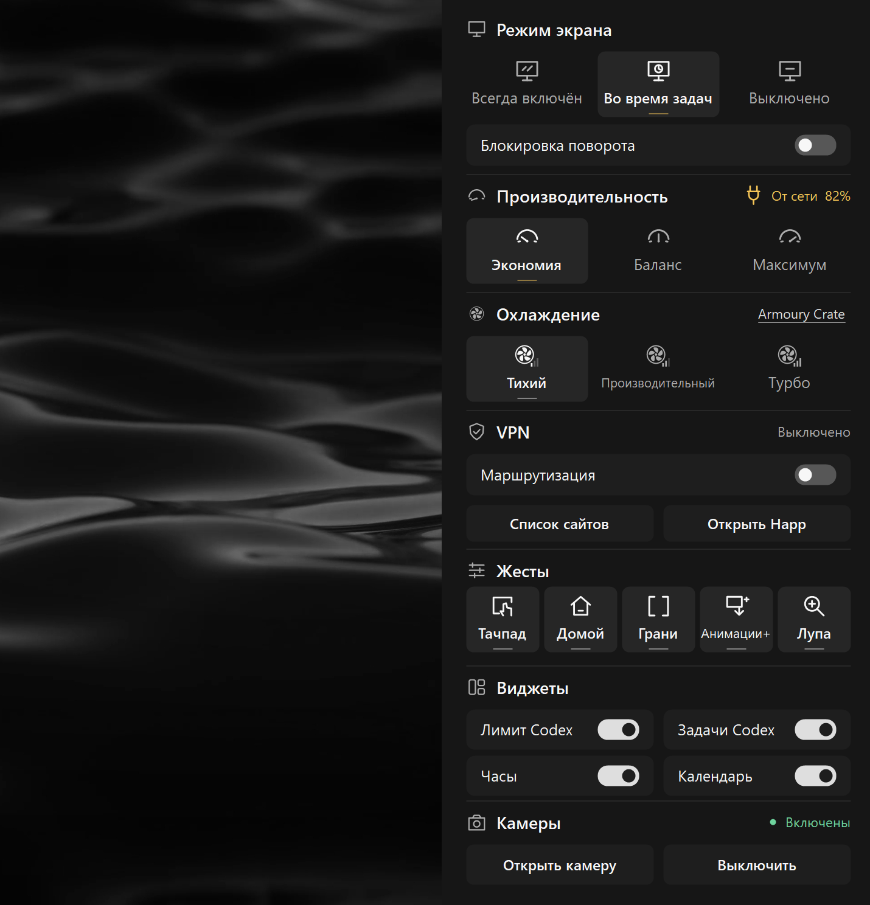
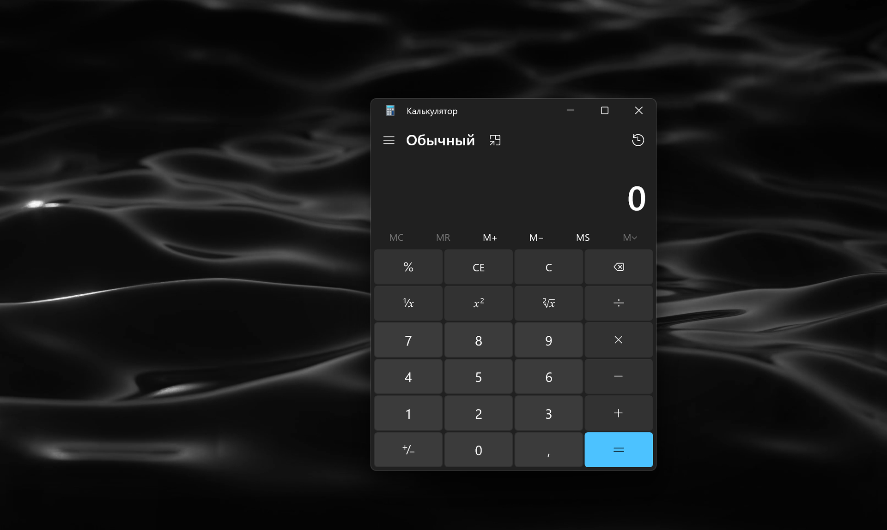
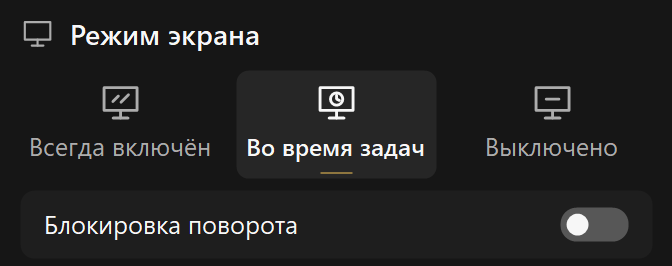
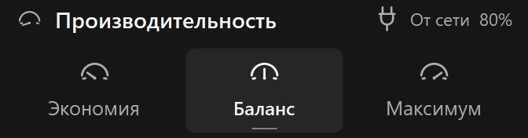
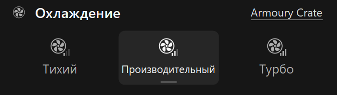
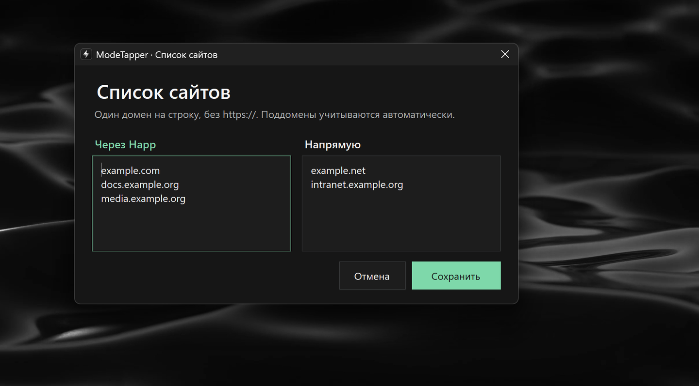
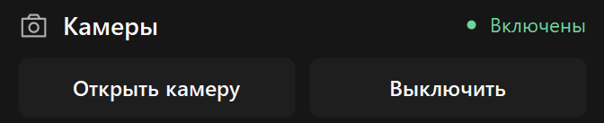
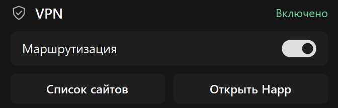
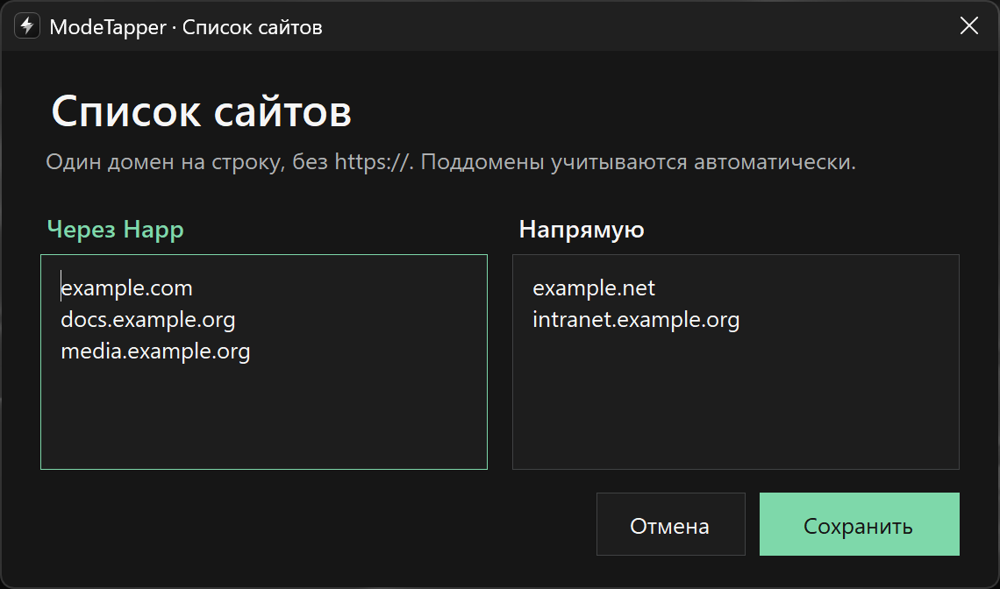
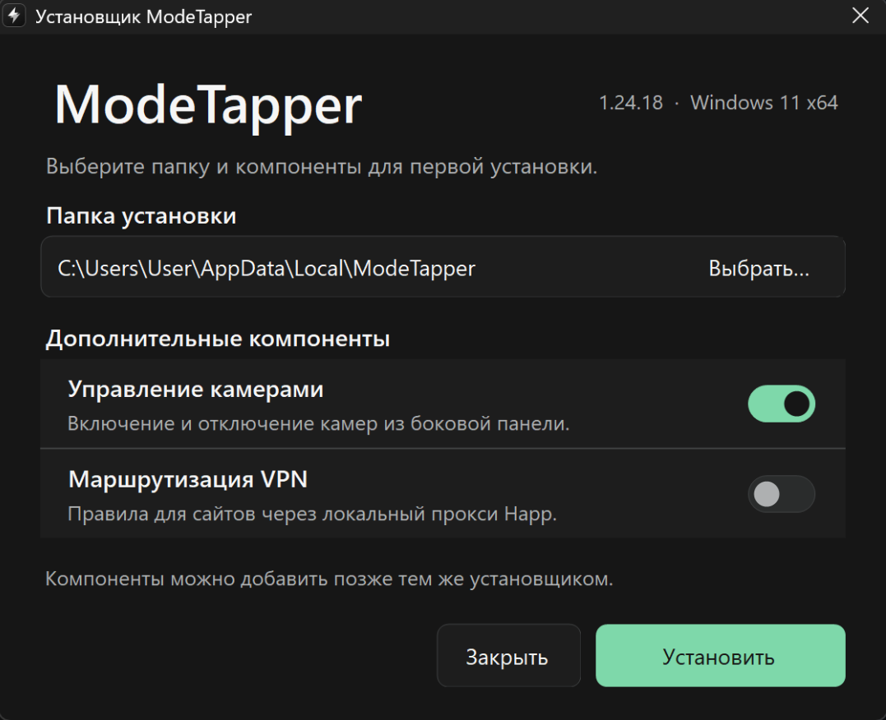

<h1 align="center">ModeTapper для ASUS ROG Flow Z13</h1>

<p align="center"><strong>Жесты, карусель окон и быстрая панель для Windows 11</strong></p>

<p align="center">Разработан на ASUS ROG Flow Z13 (2025, GZ302EA). Открывайте карусель боковой кнопкой, управляйте окнами и громкостью свайпами, переключайте профили охлаждения прямо из панели.</p>

<p align="center"><strong><a href="https://github.com/timenti/ModeTapper/releases/download/v1.24.18/ModeTapper.exe">↓ Скачать ModeTapper для Windows</a></strong><br>Версия 1.24.18 · Windows 11 x64</p>

<p align="center"><a href="#окна-под-пальцами">Карусель</a> · <a href="#карта-жестов">Жесты</a> · <a href="#экран-питание-и-охлаждение">Экран и питание</a> · <a href="#виджеты-рабочего-стола">Виджеты</a> · <a href="#анимации-окон">Анимации</a></p>

<p align="center"><a href="#лупа-и-жесты-для-фото">Лупа</a> · <a href="#управление-камерами">Камеры</a> · <a href="#маршрутизация-через-happ">Happ</a> · <a href="docs/FAQ.md">Руководство и FAQ</a></p>

<p align="center"><a href="docs/images/panel-motion.webp?raw=true"></a></p>

На **ROG Flow Z13 GZ302EA** короткое нажатие боковой клавиши открывает панель, удержание — карусель. Снимите клавиатуру, чтобы переключать окна и регулировать яркость или громкость с краёв сенсорного экрана. С клавиатурой доступны жесты Precision Touchpad, включая регулировку её подсветки.

На других ноутбуках и трансформерах с **Windows 11 x64** панель открывается через **«Пуск» → ModeTapper**. Жесты, подсветка, датчики и профили ASUS зависят от оборудования. [Совместимость](docs/FAQ.md#что-поддерживается).

## Окна под пальцами

Переключайтесь между редактором и браузером движением вбок. Если открыто много приложений, смахните двумя пальцами вверх и выберите нужное окно по превью. Когда окно больше не нужно, смахните его карточку вверх. Если в нём есть несохранённые изменения, приложение предложит сохранить их.

<p align="center"><a href="docs/images/carousel-motion.webp?raw=true"></a></p>

В карусели листайте карточки вбок и касайтесь нужной, чтобы вернуться к окну в прежнем размере. Свайп двумя пальцами вниз или **Esc** закрывает обзор. С клавиатуры можно выбрать окно стрелками **←** и **→** и открыть его через **Enter**.

## Карта жестов

Для краевых жестов начинайте движение **у самого края**. Вверх — увеличить уровень, вниз — уменьшить. На верхнем краю тачпада громкость растёт вправо и уменьшается влево.

### Тачпад с подключённой клавиатурой

| Откуда начать | Что сделать | Что произойдёт |
| --- | --- | --- |
| **Нижний край** | Два пальца вверх | Откроется карусель |
| **Нижний край** | Два пальца влево или вправо | Переключится соседнее окно |
| **Верхний край** | Один палец влево или вправо | Изменится громкость |
| **Левый край** | Один палец вверх или вниз | Изменится подсветка клавиатуры |
| **Правый край** | Один палец вверх или вниз | Изменится яркость экрана |
| **Внутри тачпада** | Развести или свести два пальца | Сработает увеличение или уменьшение масштаба, если приложение или лупа поддерживают жест |

В открытой карусели проведите двумя пальцами вбок, чтобы листать окна. Для закрытия перетащите карточку вверх с зажатой левой кнопкой. На поддерживаемом устройстве ModeTapper возвращает подсветку клавиатуры после разблокировки, если она была включена.

### Сенсорный экран без клавиатуры

| Откуда начать | Что сделать | Что произойдёт |
| --- | --- | --- |
| **Нижняя полоска** | Два пальца вверх | Откроется карусель |
| **Нижняя полоска** | Один палец влево или вправо | Переключится соседнее окно |
| **Нижняя полоска** | Один палец вверх | Сработает обычный жест Windows |
| **Левый край экрана** | Один палец вверх или вниз | Изменится яркость экрана |
| **Правый край экрана** | Один палец вверх или вниз | Изменится громкость |
| **Карточка в карусели** | Один палец вбок или вверх | Вбок — листать окна. Вверх — закрыть окно |

На трансформере жесты появятся, когда Windows распознает планшетное положение. Нижнюю полоску, грани экрана, жесты тачпада и лупу можно включать отдельно. Подробно о постановке пальцев и настройках — в [руководстве по жестам](docs/FAQ.md#какие-жесты-есть).

## Экран, питание и охлаждение

### Экран остаётся включённым, когда это нужно

<p align="center"><a href="docs/images/panel-screen.png"></a></p>

| Режим | Что делает | Когда пригодится |
| --- | --- | --- |
| **Всегда включён** | Удерживает экран включённым и откладывает сон по бездействию, пока действует режим | Читаете длинный документ, показываете экран или следите за процессом в любом приложении |
| **Во время задач** | Удерживает экран, пока ModeTapper видит выполняющуюся задачу Codex. После завершения, отмены или запроса, который остановил работу до вашего ответа, снова действует таймер Windows | Запустили сборку в Codex и хотите видеть её результат, когда вернётесь |
| **Выключено** | Возвращает таймеры дисплея и сна Windows | Хотите, чтобы ноутбук сам гасил экран и уходил в сон по обычным правилам |

Ручная блокировка и сон остаются доступны. В этой же секции можно **зафиксировать поворот**, чтобы экран оставался в выбранной ориентации.

### Производительность под вашу задачу

<p align="center"><a href="docs/images/panel-performance.png"></a></p>

| Режим | Что меняется |
| --- | --- |
| **Экономия** | Включает энергосбережение Windows и на поддерживаемом устройстве ограничивает турбоускорение процессора. Подходит для чтения, текста и работы от батареи |
| **Баланс** | Даёт максимальную производительность от сети и сбалансированный режим от аккумулятора. Удобен, если часто подключаете и отключаете зарядку |
| **Максимум** | Запрашивает максимальную производительность и от сети, и от батареи. Подходит для тяжёлой сборки или обработки, когда важна скорость |

### Охлаждение ASUS одним нажатием

<p align="center"><a href="docs/images/panel-cooling.png"></a></p>

Профили ASUS выбираются отдельно от режимов питания Windows. В панели есть три плитки, так что нужный профиль можно выбрать прямо во время работы.

| Профиль | Когда выбрать |
| --- | --- |
| **Тихий** | Читаете, пишете или разговариваете по видео и хотите меньше шума |
| **Производительный** | Ноутбук долго работает под нагрузкой и нужен штатный профиль ASUS для такой работы |
| **Турбо** | Подключили питание и хотите использовать максимальный профиль охлаждения, доступный на поддерживаемой модели |

Боковая кнопка и охлаждение проверены на **ASUS ROG Flow Z13 GZ302EA** с ASUS System Control Interface v3. Доступность профилей зависит от модели, питания и положения устройства. [Подробности о режимах и охлаждении](docs/FAQ.md#режим-экрана-питание-и-охлаждение).

## Виджеты рабочего стола

Выведите на рабочий стол то, что обычно приходится искать в отдельных окнах. Сверните редактор и сразу увидите дату, оставшийся лимит Codex и задачи, к которым можно вернуться в один клик.

<p align="center"><a href="docs/images/desktop-widgets.png"></a></p>

### Часы и календарь

**Часы** показывают местное время и дату. Нажмите на виджет, чтобы открыть «Часы» Windows и поставить таймер или будильник.

**Календарь** позволяет листать месяцы стрелками, выбирать день и переходить к другому месяцу или году через заголовок. Плитка «Сегодня» возвращает текущую дату. Удобно свериться со сроками или посчитать, сколько дней осталось до встречи.

### Лимит и задачи Codex

**Лимит Codex** показывает, сколько недельного лимита осталось и когда он обновится. Если клиент отдаёт число доступных сбросов, оно тоже видно на карточке. Нажмите на это число, чтобы открыть страницу использования. Кнопка открывает страницу, а сам сброс выполняется уже там.

**Задачи Codex** показывают активные и недавние чаты. По строке видно состояние, например выполнение или ожидание, когда его распознаёт клиент. Нажмите на задачу, чтобы сразу вернуться в её чат. Если задач много, листайте страницы стрелками.

Включайте виджеты по одному в боковой панели. Чтобы выбрать место на рабочем столе, удержите карточку примерно секунду и перетащите её мышью или пальцем. ModeTapper запомнит расположение. [Как настроить виджеты](docs/FAQ.md#виджеты-рабочего-стола).

## Лупа и жесты для фото

<p align="center"><a href="docs/images/lens-motion.webp"></a></p>

Приблизьте мелкую деталь на фотографии двумя пальцами. Включите плитку **«Лупа»**, наведите указатель на нужную область и разведите пальцы внутри тачпада. Сведите их, чтобы уменьшить масштаб. Приложения со своим зумом сохраняют привычное поведение. ModeTapper добавляет увеличение там, где может обработать жест.

В просмотрщике **Telegram Desktop** щипок приближает к указателю. После увеличения ведите два пальца вместе, чтобы перемещаться по фотографии. Начинайте в середине тачпада. Вдоль нижней грани работают жесты переключения окон. [Как пользоваться лупой](docs/FAQ.md#щипок-лупа-и-просмотр-фотографий).

## Управление камерами

<p align="center"><a href="docs/images/panel-cameras.png"></a></p>

**«Открыть камеру»** запускает приложение Windows прямо из панели. Проверьте кадр перед видеозвонком или быстро убедитесь, что камера работает.

Если при установке выбран компонент **«Управление камерами»**, плитка **«Выключить»** отключает поддерживаемые устройства камер в Windows. Панель показывает ход операции и итоговое состояние. Кнопка **«Включить»** возвращает камеры, отключённые через ModeTapper. Windows запрашивает права при переключении устройств.

Если камера используется для распознавания лица в Windows Hello, подготовьте PIN или другой способ входа перед её отключением. [Настройка и диагностика камер](docs/FAQ.md#включение-и-отключение-камер).

## Маршрутизация через Happ

<p align="center"><a href="docs/images/panel-vpn.png"></a></p>

Задайте, какие сайты открываются через локальный прокси Happ, а какие — напрямую. Например, рабочие домены можно оставить на прямом подключении, а нужные сайты прописать в отдельном списке. Правила действуют в браузерах и других приложениях, которые пользуются системным сценарием прокси Windows (PAC).

1. Откройте **Happ** из панели и включите его локальный прокси.
2. В **«Списке сайтов»** добавьте домены в колонки **«Через Happ»** и **«Напрямую»**. Указывайте по одному домену на строку. Правила также учитывают поддомены.
3. Сохраните список и включите **«Маршрутизацию»**. В панели виден статус подключения к прокси.

<p align="center"><a href="docs/images/vpn-sites.png"></a></p>

Когда завершите работу, выключите маршрутизацию этой же плиткой. ModeTapper восстановит предыдущие параметры системного прокси, если их не успела изменить другая программа. [Как настроить Happ и проверить маршрут](docs/FAQ.md#маршрутизация-выбранных-сайтов-через-happ).

## Анимации окон

Включите плитку **«Анимации+»** и откройте приложение с рабочего стола. В поддерживаемых окнах переход показывает, откуда появилось окно и куда оно свернулось. Нагляднее всего это видно, когда работаешь сразу с несколькими приложениями.

<p align="center"><a href="docs/images/window-motion.webp?raw=true"></a></p>

| Действие | Что увидите |
| --- | --- |
| **Запуск с ярлыка** | Окно раскрывается от значка, когда ModeTapper может определить его положение |
| **Сворачивание** | Окно складывается к значку на панели задач. Где значок недоступен, переход может начинаться от края экрана |
| **Восстановление** | Окно раскрывается обратно из значка панели задач |
| **Закрытие** | Окно уменьшается и плавно исчезает |

Работа эффекта зависит от способа запуска приложения и настройки анимаций Windows. Плитку можно переключить в любой момент. [Подробности о переходах](docs/FAQ.md#как-работают-анимации).

## Установка

1. [Скачайте ModeTapper.exe](https://github.com/timenti/ModeTapper/releases/download/v1.24.18/ModeTapper.exe) и выберите папку при первой установке.
2. Включите **«Управление камерами»**, **«Маршрутизация VPN»** или обе функции по желанию. Нажмите **«Установить»**.

   <p align="center"><a href="docs/images/installer.png"></a></p>

3. Откройте **«Пуск» → ModeTapper** и включите нужные плитки.

Установка для текущего пользователя Windows 11 x64 проходит без прав администратора. Если Windows показывает предупреждение SmartScreen, сверьте скачанный файл по контрольной сумме. С дополнительным компонентом камер Windows запросит права при переключении устройств. [SHA-256](https://github.com/timenti/ModeTapper/releases/download/v1.24.18/SHA256SUMS.txt) · [Как проверить файл](docs/FAQ.md#почему-windows-предупреждает-при-запуске) · [Все релизы](https://github.com/timenti/ModeTapper/releases)

Запустите установщик снова, чтобы добавить пропущенный компонент. Если установлена более ранняя версия, он предложит **«Обновить»**. Для той же версии кнопка **«Восстановить»** заново установит файлы и ярлыки, сохранив настройки. [Что нового в 1.24.18](https://github.com/timenti/ModeTapper/releases/tag/v1.24.18).

Для жестов тачпада нужен совместимый **Precision Touchpad**. Краевые жесты экрана требуют поддержки планшетного положения Windows. Доступность управления яркостью и подсветкой зависит от устройства. [Требования и диагностика](docs/FAQ.md).

<details>
<summary>Сборка из исходников</summary>

```powershell
./work/Build-ModeTapper.ps1
./work/Install-ModeTapper.ps1
```

`./work/Build-Installer.ps1` собирает установщик в `dist/ModeTapper.exe`.

</details>

[Лицензия MIT](LICENSE) · *powered by timenti*
