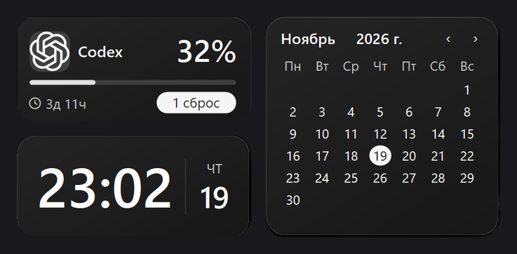

# ModeTapper

**Карусель окон, жесты от краёв экрана и боковая панель быстрых настроек для Windows 11.**

### [↓ Скачать ModeTapper 1.24.16 для Windows](https://github.com/timenti/ModeTapper/raw/refs/heads/downloads-v1.24.16/ModeTapper.exe)

[SHA-256](https://github.com/timenti/ModeTapper/blob/downloads-v1.24.16/SHA256SUMS.txt) · [Все релизы](https://github.com/timenti/ModeTapper/releases) · [Руководство и FAQ](docs/FAQ.md) · [Лицензия MIT](LICENSE)

[](docs/images/panel-motion.webp?raw=true)

На совместимом ASUS панель открывается коротким нажатием боковой клавиши. На любом поддерживаемом ПК её можно открыть через **«Пуск» → ModeTapper**.

## Карусель окон и жесты

Смахните двумя пальцами вверх от штатной нижней полоски в планшетном режиме или от нижнего края тачпада. Окна соберутся в карусель с предпросмотром. Листайте карточки вбок, бросайте их по инерции или коснитесь нужной, чтобы вернуться в приложение. Карточку можно смахнуть вверх, чтобы закрыть окно. При возврате ModeTapper сохраняет обычный или развёрнутый размер окна.

[](docs/images/carousel-motion.webp?raw=true)

Горизонтальный свайп от полоски переключает соседние окна одним пальцем. На тачпаде открытие карусели и быстрые переходы начинаются двумя пальцами от нижнего края. Вертикальный свайп вдоль левого края сенсорного экрана регулирует яркость, вдоль правого — громкость. На тачпаде также есть жест для подсветки клавиатуры. [Все жесты](docs/FAQ.md#какие-жесты-есть)

## Анимации окон

Плитка **«Анимации+»** включает дополнительные переходы. При раскрытии окно разворачивается от значка, при сворачивании складывается к нему. Если значок недоступен, переход использует край экрана.

[](docs/images/window-motion.webp?raw=true)

## Быстрые настройки

| Раздел | Что можно сделать |
| --- | --- |
| **Экран** | Удерживать экран включённым всегда или во время распознанных задач Codex, вернуть обычное поведение Windows, зафиксировать поворот. |
| **Производительность** | Переключаться между экономией, балансом и максимальной производительностью. |
| **Охлаждение** | Выбрать тихий, производительный или турбо-профиль, если устройство поддерживается. |
| **Жесты** | Настроить функции тачпада и сенсорного экрана, включить карусель, лупу и дополнительные анимации. |
| **Виджеты** | Показать часы, календарь, состояние задач и недельный лимит Codex. Виджеты можно перетащить удержанием. |
| **Камеры** | Открыть «Камеру» Windows. С установленным компонентом можно также отключать и включать устройства камер из панели. |
| **Маршрутизация** | Направлять выбранные сайты через локальный прокси Happ. |

## Виджеты рабочего стола

[](docs/images/desktop-widgets.png)

- **Часы** показывают текущее время и дату.
- **Календарь** позволяет листать даты и выбирать месяц и год прямо в виджете.
- **Лимит Codex** показывает остаток недельного лимита и время до обновления. Кнопка с числом доступных сбросов открывает страницу использования.
- **Задачи Codex** показывают активные и недавние чаты. Нажатие на строку открывает соответствующий чат.

Включайте нужные виджеты в панели ModeTapper. Чтобы переместить виджет, удержите его и перетащите в другую ячейку сетки рабочего стола.

## Установка

1. [Скачайте ModeTapper.exe](https://github.com/timenti/ModeTapper/raw/refs/heads/downloads-v1.24.16/ModeTapper.exe).
2. Выберите папку при первой установке и нажмите **«Установить»**. При обновлении используется папка действующей версии.
3. Запустите панель из меню **«Пуск» → ModeTapper**.

Установка для текущего пользователя Windows 11 x64 проходит без PowerShell и прав администратора. Если выбран компонент камер, Windows запросит разрешение при переключении самих устройств. На скачанном установщике Windows может показать предупреждение SmartScreen. [Как проверить файл](docs/FAQ.md#почему-windows-предупреждает-при-запуске).

Сенсорные жесты требуют совместимого экрана, жесты тачпада — Precision Touchpad. Боковая кнопка и управление охлаждением проверены на ASUS ROG Flow Z13 GZ302EA. На других моделях доступность этих функций зависит от оборудования и драйверов.

## Для разработки

```powershell
./work/Build-ModeTapper.ps1
./work/Install-ModeTapper.ps1
```

Команда `./work/Build-Installer.ps1` собирает установщик в `dist/ModeTapper.exe`. Требования, карту жестов, описание настроек и диагностику см. в [руководстве ModeTapper](docs/FAQ.md).

*powered by timenti*
