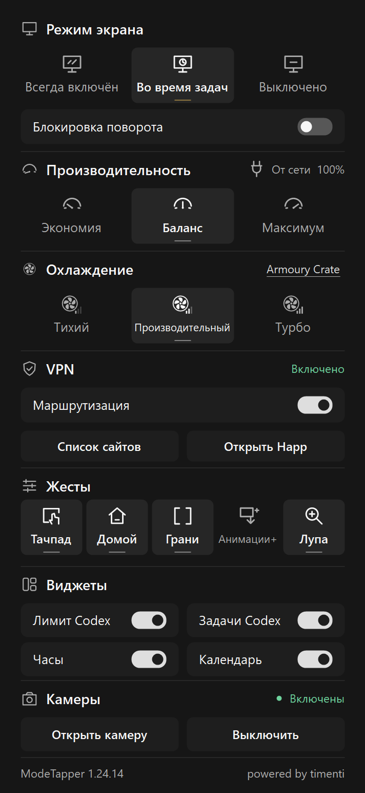

# ModeTapper

**Быстрые настройки и жесты для Windows-ноутбуков и трансформеров.**

ModeTapper собирает управление экраном, питанием и окнами в одной боковой панели. На сенсорном устройстве можно переключать окна свайпом, а на обычном ноутбуке — управлять теми же функциями с тачпада.



## Возможности

- **Экран и питание.** Три режима экрана, блокировка поворота, экономия, баланс и максимальная производительность.
- **Жесты.** Регулировка яркости, громкости и подсветки, переключение окон и карусель приложений. На планшете карусель открывается свайпом двумя пальцами вверх от штатной нижней полоски.
- **Рабочий стол.** Часы, календарь, статус задач и лимит Codex, лупа и дополнительные анимации окон.
- **Оборудование.** На проверенном ASUS ROG Flow Z13 работает боковая кнопка и переключение профилей охлаждения. Регулировки зависят от модели и драйверов.
- **Дополнительно.** Открытие приложения «Камера», управление доступностью камер при отдельной установке и выборочная маршрутизация сайтов через локальный прокси Happ.

## Сборка и запуск

Откройте PowerShell в папке репозитория на Windows 11 x64. Для сборки используются .NET Framework и системный компилятор C#.

```powershell
./work/Build-ModeTapper.ps1
./work/Install-ModeTapper.ps1
```

Установка добавляет ModeTapper в меню «Пуск» и автозагрузку текущего пользователя. На проверенном Flow Z13 короткое нажатие боковой кнопки открывает панель, а удержание — карусель. На других устройствах панель можно открыть из «Пуска».

Перед использованием функций, зависящих от железа, сверяйтесь с [FAQ и картой жестов](docs/FAQ.md).
