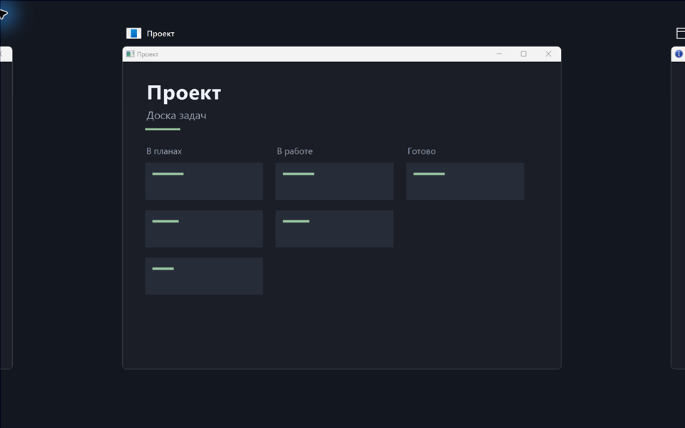
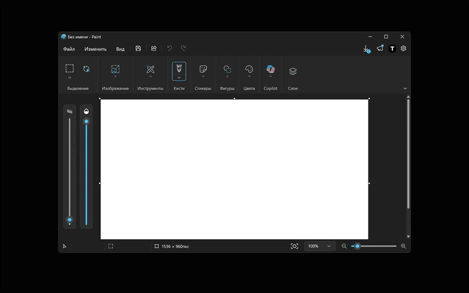

# ModeTapper

**Карусель окон, жесты от краёв экрана и боковая панель быстрых настроек для Windows 11.**

<a href="https://github.com/timenti/ModeTapper/releases/latest/download/ModeTapper.exe"></a>

[Все релизы](https://github.com/timenti/ModeTapper/releases) · [Карта жестов и FAQ](docs/FAQ.md) · [Лицензия MIT](LICENSE)



## Окна и жесты

Смахните двумя пальцами вверх от штатной нижней полоски в планшетном режиме. Окна соберутся в карусель с предпросмотром. Листайте карточки вбок, бросайте их по инерции или коснитесь нужной, чтобы вернуться в приложение. Карточку можно смахнуть вверх, чтобы закрыть окно. При возврате ModeTapper сохраняет обычный или развёрнутый размер окна.



Горизонтальный свайп от полоски переключает соседние окна одним пальцем. На тачпаде открытие карусели и быстрые переходы начинаются двумя пальцами от нижнего края. Вертикальный свайп вдоль левого края сенсорного экрана регулирует яркость, вдоль правого — громкость. На тачпаде также есть жест для подсветки клавиатуры. [Все жесты](docs/FAQ.md#какие-жесты-есть)

## Анимации окон

Плитка **«Анимации+»** включает дополнительные переходы. При раскрытии окно разворачивается от значка, при сворачивании складывается к нему. Если значок недоступен, переход использует край экрана. Гифка ниже показывает геометрию перехода на демонстрационном окне.


## Быстрые настройки


| Раздел | Что можно сделать |
| --- | --- |
| **Экран** | Удерживать экран включённым всегда или во время распознанных задач Codex, вернуть обычное поведение Windows, зафиксировать поворот. |
| **Производительность** | Переключаться между экономией, балансом и максимальной производительностью. |
| **Охлаждение** | Выбрать тихий, производительный или турбо-профиль, если устройство поддерживается. |
| **Жесты** | Настроить функции тачпада и сенсорного экрана, включить карусель, лупу и дополнительные анимации. |
| **Виджеты** | Показать часы, календарь, состояние задач и недельный лимит Codex. Виджеты можно перетащить удержанием. |
| **Камеры** | Открыть штатную «Камеру» Windows. Блокировка камер доступна после отдельной установки компонента. |
| **Маршрутизация** | Направлять выбранные сайты через локальный прокси Happ. |

## Установка

1. [Скачайте ModeTapper.exe](https://github.com/timenti/ModeTapper/releases/latest/download/ModeTapper.exe).
2. Откройте установщик и нажмите **«Установить»**.
3. Запустите панель из меню **«Пуск» → ModeTapper**.

Установщик рассчитан на Windows 11 x64 и устанавливает программу для текущего пользователя. Сборка исходников и ручной запуск PowerShell не требуются. Установщик пока без цифровой подписи. В релизе опубликована контрольная сумма SHA-256.

Сенсорные жесты требуют совместимого экрана, жесты тачпада — Precision Touchpad. Боковая кнопка и управление охлаждением проверены на ASUS ROG Flow Z13 GZ302EA. На других моделях доступность этих функций зависит от оборудования и драйверов.

## Для разработки

```powershell
./work/Build-ModeTapper.ps1
./work/Install-ModeTapper.ps1
```

Команда `./work/Build-Installer.ps1` собирает установщик в `dist/ModeTapper.exe`. Информация об обновлении, камерах, виджетах и диагностике есть в [FAQ](docs/FAQ.md).

*powered by timenti*
