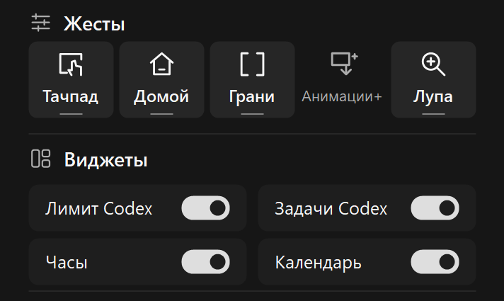

# FAQ

## На каких компьютерах работает ModeTapper?

Приложение рассчитано на Windows 11 x64. Панель открывается из меню «Пуск». Сенсорные жесты требуют совместимого экрана, жесты тачпада — Precision Touchpad. Боковая кнопка и профили охлаждения проверены на ASUS ROG Flow Z13 GZ302EA с ASUS System Control Interface v3. Для других моделей доступность этих функций пока не подтверждена.

## Какие жесты есть?

| Где | Движение | Действие |
| --- | --- | --- |
| Штатная нижняя полоска планшета | Два пальца вверх | Открыть карусель |
| Там же | Один палец влево или вправо | Переключить окно |
| Нижний край тачпада | Два пальца вверх | Открыть карусель |
| Нижний край тачпада | Два пальца вбок | Переключить окно |
| В карусели | Два пальца вбок | Пролистать карточки |
| В карусели | Два пальца вниз | Вернуться к окну |
| Края сенсорного экрана | Вверх или вниз | Слева яркость, справа громкость |
| Края тачпада | Вдоль края | Слева подсветка клавиатуры, справа яркость экрана, сверху громкость |

## Что нужно для виджетов Codex?

Часы и календарь работают локально. Для лимита нужен установленный и авторизованный Codex. Виджет задач показывает состояние, которое приложение может определить по локальным данным Codex.

## Что делает маршрутизация?

Она направляет указанные сайты через локальный прокси Happ в приложениях, учитывающих системный PAC. При чистой установке маршрутизация выключена и списки пусты. Включите её после настройки Happ и добавьте нужные домены через «Список сайтов».

## Как включить управление камерами?

Открытие приложения «Камера» использует штатную Windows Camera. Для отключения устройств камеры при установке передайте `-InstallCameraControls`. Windows запросит разрешение администратора при регистрации задач.

## Как обновиться со старой Luma?

Запустите обычную установку ModeTapper. Она находит управляемую установку Luma в профиле пользователя и переносит настройки, виджеты и журналы восстановления. Настройки ModeTapper хранятся в `%LOCALAPPDATA%\ModeTapper`.

## Что делать, если программа открылась в безопасном режиме?

Безопасный режим приостанавливает системные изменения. Откройте ModeTapper из «Пуска» и попробуйте «Возобновить работу ModeTapper». Если остаётся ошибка, диагностический журнал находится в `%LOCALAPPDATA%\ModeTapper\safety`. Перед публикацией журнала проверьте его на локальные пути и настройки.
