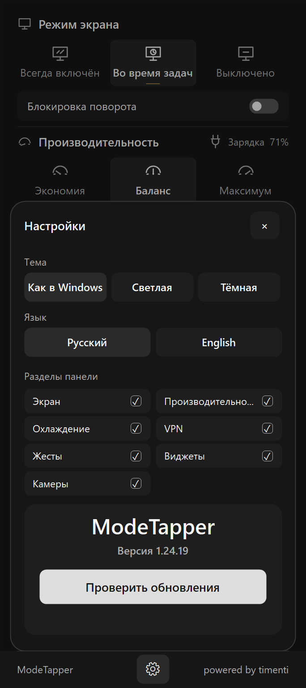
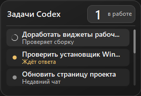

## Что нового в ModeTapper 1.24.19

- Шестерёнка в футере открывает настройки с системной, светлой и тёмной темами, русским и английским языками и выбором видимых разделов. Там же можно проверить текущую версию и наличие обновления на GitHub.
- Для подписанной установки доступно обновление в один клик с ходом загрузки в настройках и сохранением выбранных компонентов.
- При ошибке панель показывает кнопку «Скачать вручную». Перед установкой ModeTapper проверяет контрольную сумму, версию и подпись издателя.
- Виджет «Задачи Codex» показывает крупный счётчик задач в работе и отдельные карточки чатов. Список прокручивается мышью и касанием, а ширина учитывает сетку ярлыков Windows.

[Руководство по обновлению](https://github.com/timenti/ModeTapper/tree/v1.24.19#обновление-из-modetapper)
