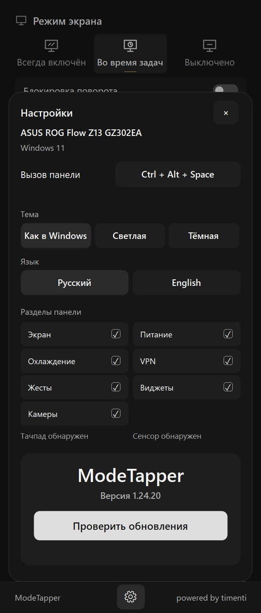
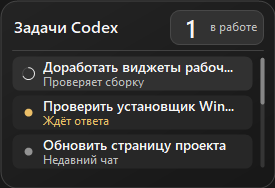

## Что нового в ModeTapper 1.24.20

- **Панель на любом ПК с Windows 11 x64.** Открывайте её по Ctrl + Alt + Пробел, через трей или ярлык. Назначьте свою клавишу или сочетание в настройках. Карусель открывается мышью, с клавиатуры или жестом.
- **Совместимость и охлаждение.** ModeTapper показывает модель устройства, версию Windows и доступность функций. На совместимом ASUS используются профили драйвера, в том числе без Armoury Crate. Если оборудование предоставляет политику охлаждения Windows, можно выбрать активное или пассивное охлаждение.
- **Сенсор и тачпад.** Жесты работают при подключении совместимого Precision Touchpad или сенсорного экрана. Яркость внешнего монитора регулируется при поддержке DDC/CI.
- **Настройки и обновления.** Шестерёнка открывает выбор темы, языка, горячей клавиши и видимых разделов. Здесь можно проверить версию и наличие выпуска на GitHub.
- **Виджет «Задачи Codex».** Крупный счётчик и карточки чатов с прокруткой показывают, что выполняется сейчас.

Скачайте **ModeTapper.exe** из файлов релиза. Эта сборка без подписи, поэтому обновление устанавливается вручную. Установщик сохранит настройки и компоненты. Контрольная сумма находится в **SHA256SUMS.txt**.

[Руководство и демонстрации](https://github.com/timenti/ModeTapper/tree/v1.24.20#readme)
