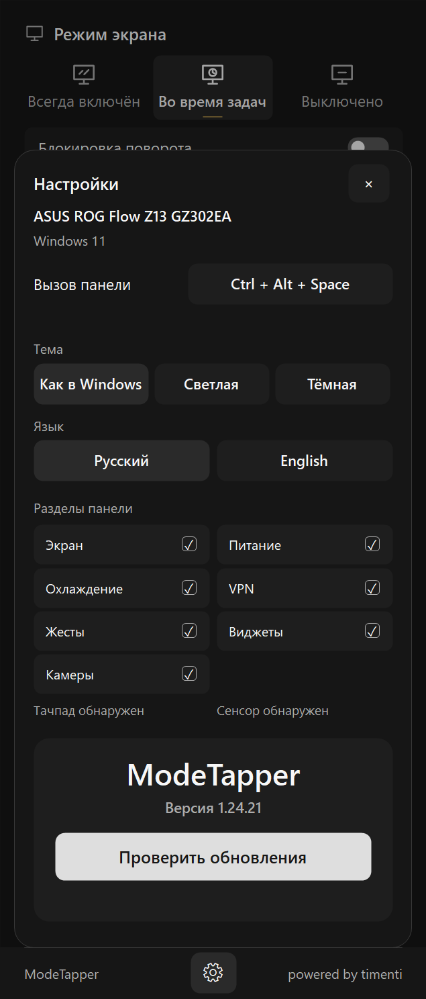

## Что нового в ModeTapper 1.24.21

- **Проверка обновлений в настройках.** Кнопка «Обновить» открывает загрузку установщика с GitHub. Запустите скачанный файл, чтобы заменить текущую версию и сохранить настройки и компоненты.
- **Загрузка с GitHub.** Если проверка обновлений недоступна, кнопка «Скачать вручную» открывает страницу последнего релиза.
- **Переход с прежней версии.** Один раз скачайте и запустите ModeTapper.exe из этого выпуска. Установщик сохранит настройки и установленные компоненты.

[Руководство и демонстрации](https://github.com/timenti/ModeTapper/tree/v1.24.21#readme)
